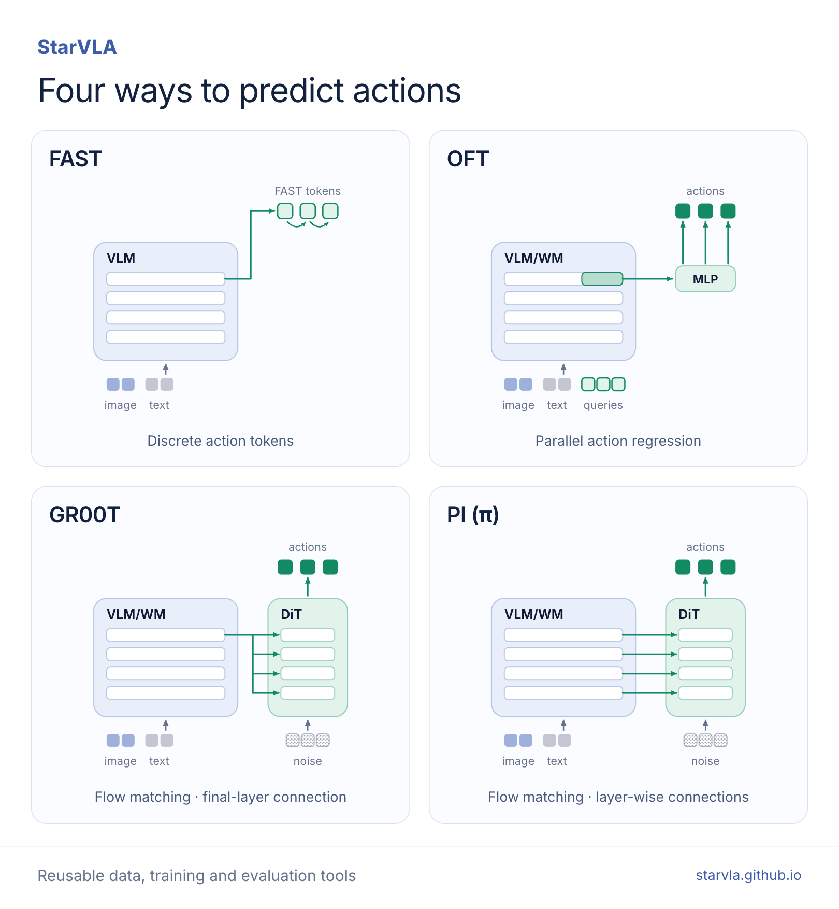

# StarVLA 首次 X 宣传计划

更新于 2026-11-17。这里准备 StarVLA 第一次在 X 上的正式系列宣传，包括逐条文案、图片、视频和发布安排。**当前全部为待发布稿，以下内容与素材尚未发布到 X。**

## 如何协作

1. 在下方分工表认领熟悉的话题，填写发布人。
2. 在本 README 修改对应帖子的文案，并同步 `posts/` 中的纯文本。
3. 从对应编号的 `media/` 文件夹选择视频或图片，预览后发布。
4. 发布后补充日期和推文链接，方便其他参与者引用。

```
README.md           统一计划、分工、文案和发布记录
posts/              七条可直接复制的英文稿
media/01-homepage/  主页图片
media/02-overview/  完整宣传视频与封面
media/03-models/    模型片段与结构图
media/04-benchmarks/ 评测片段与机器人演示
media/05-results/   结果动画
media/06-training/  训练片段与配置图
media/07-community/ 社区、star 动画与曲线数据
```

## 背景与表达方式

StarVLA 已经开源并持续维护了一段时间，也有社区在实际使用。这次以主页更新为入口，正式向 X 上的研究者介绍项目，随后用几个具体话题展开它能支持的工作。

宣传可以比论文更直接。开头用接近 4,000 stars 和 60+ 社区项目吸引关注，后续通过模型结构、视频演示、训练配方和社区工作提供具体内容。对外使用 `refreshed homepage`、`built with StarVLA`、`reusable tools` 等表述，不写成项目刚刚开源，也不需要每条重复强调规模。

每条有一个话题、一份与话题直接相关的素材，以及一个可继续了解的入口。完整视频承担概览，短片和结构图分别展开具体能力。

后续技术帖从读者能做什么、可以用什么开始：搭建自己的模型、接入评测、从参考配方开始实验、配置训练数据，以及寻找社区实现。第二句再说明 StarVLA 提供的工具、覆盖范围或具体例子，让读者一眼知道这条内容对自己的工作有什么用。

## 同日协作发布 讨论稿

这轮考虑在同一天集中介绍 StarVLA，由不同参与者认领自己熟悉的话题。主账号或项目账号发布主页更新和完整介绍，参与模型、训练、评测或社区维护的同学再从各自的工作出发展开。具体发布人和时间先留待讨论。

| Post | 话题 | 素材 | 建议认领方向 | 发布人 |
| --- | --- | --- | --- | --- |
| 1 | 新主页与已有社区规模 | 主页链接卡片 | 主账号或项目账号，作为本次介绍的入口 | 待定 |
| 2 | 70 秒认识 StarVLA | 完整宣传视频 | 可由主帖账号接续发布，组成简短 thread | 待定 |
| 3 | 从已有 VLM 或 world model 构建自己的 VLA | 模型组合短片，或动作头结构图 | 参与模型与框架开发的同学 | 待认领 |
| 4 | 用现有 benchmark 集成评测自己的模型 | 部署短片，或机器人演示合集 | 参与评测与部署的同学 | 待认领 |
| 5 | 从现成 baseline 开始自己的实验 | 结果动画 | 熟悉训练配方与 benchmark 结果的同学 | 待认领 |
| 6 | 按研究需求组合训练数据 | 训练短片 | 参与数据与训练工具的同学 | 待认领 |
| 7 | 从社区研究中寻找思路和实现 | 社区短片与 star 增长动画 | 主账号、项目账号或社区维护参与者 | 待定 |

当天先发布主页主帖与总览视频，其他参与者随后围绕认领的话题发布，可以引用主帖，也可以独立成帖。每条保留一个明确的内容重点，并附上对应素材和资源入口。同一位参与者可以负责相关的两个话题。

当前英文稿作为大家认领时的基础稿。确定发布人后，再加入其实际参与的内容或个人视角；具体姓名、账号和发布日期填入本页。**目前为分工讨论稿，认领后更新发布人和时间。**

Post 4 展示集成范围，Post 5 展示参考结果，分别对应不同话题。素材中保留 benchmark 名称；结果图保留方法名称、图例和原有设置说明。

## Post 1 新主页

以主页更新为入口，介绍 StarVLA 已有的资源和社区积累。

```text
We’ve refreshed the StarVLA homepage!

StarVLA is nearing 4,000 GitHub stars, with 60+ community projects building on it.

Explore policy architectures, training recipes, benchmarks, and community projects built with StarVLA.
https://starvla.github.io/
```

**素材：主页链接卡片。** 先不附加图片或视频，发帖时检查编辑器中的卡片预览。主页当前配置的卡片图片是系统总览图；[主页截图](media/01-homepage/homepage.png)可作备用。

## Post 2 完整视频介绍

先让读者了解项目整体，再通过后续短帖展开。

```text
Building your own VLA? Here's a 70-second tour of StarVLA.

Start from pretrained components, develop your own model, and reuse tools for data loading, training and evaluation.

Open-source infra for robot learning research.
https://github.com/starVLA/starVLA
```

**素材：[完整视频，50% 音量](media/02-overview/overview-voice50.mp4)。** 1920×1080，约 70 秒、11 MB。也提供[静音版](media/02-overview/overview-silent.mp4)和[封面](media/02-overview/cover.png)。

## Post 3 从已有基础模型构建自己的 VLA

先说明读者可以从自己选择的 VLM 或 world model 开始构建 VLA，再解释动作头与连接的可修改性，以及可继续复用的工具。

```text
Build your own VLA around your choice of VLM or world model.

Combine pretrained backbones with action heads, customize their connections, and reuse StarVLA's data, training and evaluation tools.

https://github.com/starVLA/starVLA
```

**首选素材：[模型组合短片，11.93 秒](media/03-models/model-composition-voice50.mp4)。** 同时展示不同 backbone 与 action head，呼应从已有基础模型开始构建的主题。

静态备选：[四种动作头，2×2 排列](media/03-models/action-heads.png)，从真实主页 SVG 重新排版。



## Post 4 Benchmark 集成

让读者先看到可以直接利用的评测集成，再用仿真演示说明环境覆盖；共同部署接口作为支持这件事的工具。

```text
Evaluate your VLA with ready-to-use benchmark integrations.

StarVLA provides 13 simulation benchmark integrations and a shared policy-serving interface for simulation and real robots.

https://starvla.github.io/#benchmarks
```

**首选素材：[Benchmark 与部署短片，13.07 秒](media/04-benchmarks/benchmark-integration-voice50.mp4)。** 展示现有集成与共用的部署接口。

**演示备选：[18 秒机器人演示合集](media/04-benchmarks/robot-demos.mp4)。** SimplerEnv、RoboCasa-GR1、RoboTwin 2.0 各 6 秒，960×780，无音轨，约 1.6 MB。片段分别标明环境名称。[封面](media/04-benchmarks/robot-demos-cover.jpg)也已准备。它们来自主页的仿真演示，对应不同环境的示例。

## Post 5 参考结果与 baseline

让读者从现有配方和 checkpoint 开始自己的实验。结果动画说明这些参考模型的表现，与 Post 4 的环境集成话题错开。

```text
Start your next experiment with a ready-to-use baseline.

StarVLA provides training recipes, checkpoints and reference results across LIBERO, SimplerEnv, RoboTwin and RoboCasa.

https://starvla.github.io/#benchmarks
```

**素材：[结果动画，6.93 秒](media/05-results/benchmark-results-voice50.mp4)。** 直接截取原宣传视频，保留数值、方法标签和设置说明。[静音版](media/05-results/benchmark-results-silent.mp4)也可直接使用。

## Post 6 数据与训练

从研究者的数据选择出发，说明如何组合机器人示范、跨本体数据与视觉语言数据开展训练。

```text
Train with the data mix your research needs.

Use robot demonstrations, mix data across embodiments, or co-train with vision-language data. StarVLA provides configurable mixtures and reusable training tools.

https://github.com/starVLA/starVLA
```

**素材：[训练方式短片，8.73 秒](media/06-training/training-voice50.mp4)。** [主页模型与训练配置界面](media/06-training/experiment-config.png)可作配图备选，偏重实验配置的说明。

## Post 7 社区研究

让读者从社区工作中寻找研究思路和实现参考，并感谢实际贡献。star 曲线展示关注的增长，社区项目展示实际研究使用。

```text
Find ideas and implementations for your next robot learning project.

StarVLA is nearing 4,000 GitHub stars, with 60+ community projects building on it. Thanks to everyone sharing code, ideas and feedback!
https://starvla.github.io/#research
```

**首选素材：[star 增长与社区项目合集](media/07-community/stars-and-projects.mp4)。** 先展示 star 历史曲线，再展示社区研究项目，分别说明关注增长与研究使用。

也提供[独立 star 增长动画](media/07-community/star-growth.mp4)、[GIF 版](media/07-community/star-growth.gif)和[最终画面](media/07-community/star-growth-cover.png)。[原社区短片](media/07-community/community-projects-voice50.mp4)和[社区项目截图](media/07-community/community-projects.png)保留备用。

动画重新绘制了[Star History 站点](https://simrepo.dera.page/starVLA/starVLA?legend=bottom-right)公开接口的 251 条记录，时间为 2025-10-10 至 2026-11-13，终点为 3,939 stars；图中保留来源与截止日期。首帖的实时数量和该历史快照对应不同日期，英文稿统一使用 `nearing 4,000`。[原始记录 CSV](media/07-community/star-history.csv)和[最终曲线 SVG](media/07-community/star-growth.svg)保存在同一素材目录，方便后续更新。

## 视频拆分

以 [完整宣传视频](media/02-overview/overview-voice50.mp4) 为统一来源。Post 2 使用完整视频，其他帖子按实际场景选择片段，避免每条重新制作一套视觉。

- 按场景与旁白断句切分，每段只讲一个主题。
- 保持现有 50% 音量，提供有声与静音版本。
- 不额外加速；保留能理解模型图和结果图的停留时间。
- 切片清单记录来源、起止时间和对应 Post，方便后续调整。

| 主题 | 源视频时间 | 时长 | 对应 Post | 有声版 | 静音版 |
| --- | --- | --- | --- | --- | --- |
| 模型组合 | 10.90–22.83 秒 | 11.93 秒 | 3 | [播放](media/03-models/model-composition-voice50.mp4) | [播放](media/03-models/model-composition-silent.mp4) |
| 训练方式 | 23.10–31.83 秒 | 8.73 秒 | 6 | [播放](media/06-training/training-voice50.mp4) | [播放](media/06-training/training-silent.mp4) |
| Benchmark 与部署 | 32.30–45.37 秒 | 13.07 秒 | 4 | [播放](media/04-benchmarks/benchmark-integration-voice50.mp4) | [播放](media/04-benchmarks/benchmark-integration-silent.mp4) |
| Benchmark 结果 | 45.70–52.63 秒 | 6.93 秒 | 5 | [播放](media/05-results/benchmark-results-voice50.mp4) | [播放](media/05-results/benchmark-results-silent.mp4) |
| 社区研究 | 53.03–61.10 秒 | 8.07 秒 | 7 | [播放](media/07-community/community-projects-voice50.mp4) | [播放](media/07-community/community-projects-silent.mp4) |

五段均为 1920×1080、30 fps。每段的有声版、静音版和封面，保存在对应帖子的 `media/` 子目录中。

## 执行与素材入口

发布前确认话题认领人、英文稿和一份主素材，预览文字、画面与链接。主帖发布后把链接补入本页，供当天参与者引用；发布后逐条记录实际链接。

| Post | 当前状态 | 实际发布日期 | 推文链接 |
| --- | --- | --- | --- |
| 1 | 文案已备好；主页卡片待发帖预览 | 待定 | 待发布 |
| 2 | 文案已备好；完整视频已备好 | 待定 | 待发布 |
| 3 | 建议稿；2×2 模型图已备好 | 待定 | 待发布 |
| 4 | 建议稿；部署短片与主页演示合集已备好 | 待定 | 待发布 |
| 5 | 建议稿；结果动画已备好 | 待定 | 待发布 |
| 6 | 建议稿；训练短片已备好 | 待定 | 待发布 |
| 7 | 建议稿；star 动画与社区素材已备好 | 待定 | 待发布 |

当前文案以本 README 为准，[posts/](posts/) 提供七条可直接复制的纯文本。修改某条文案后，同时更新对应的 `.txt` 文件。

素材来源包括[公开主页](https://starvla.github.io/)、现有宣传视频、真实主页 SVG 和界面截图。演示片段来自主页的 SimplerEnv、RoboCasa-GR1 与 RoboTwin 2.0 视频。2026-11-16 的 GitHub API 核对结果为 3,950 stars，主页收录 61 个社区项目，因此首帖使用 `nearing 4,000` 和 `60+ community projects`。发布时按当天情况更新这两处数字即可。
